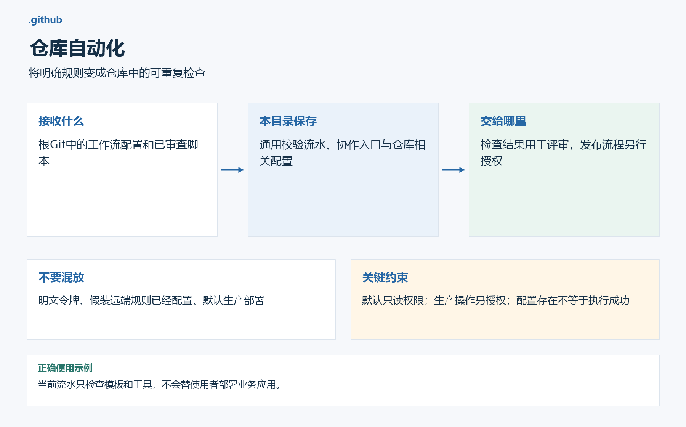

# .github｜仓库自动化

将明确规则变成仓库中的可重复检查。

## 什么时候来这里

当你需要处理“根Git中的工作流配置和已审查脚本”时，从这里找到对应规则或维护位置。

## 收什么、存什么、交给谁

| 问题 | 具体说明 |
| --- | --- |
| 输入来自哪里 | 根Git中的工作流配置和已审查脚本 |
| 本目录保存什么 | 通用校验流水、协作入口与仓库相关配置 |
| 产出交给哪里 | 检查结果用于评审，发布流程另行授权 |
| 不应放什么 | 明文令牌、假装远端规则已经配置、默认生产部署 |
| 必须遵守 | 默认只读权限；生产操作另授权；配置存在不等于执行成功 |

## 一次正确使用

当前流水只检查模板和工具，不会替使用者部署业务应用。

先明确这是原始输入、已确认事实、需求定义、计划还是实际结果，再选择文件位置。若已有唯一维护位置，新增材料引用它，不复制一份持续更新的状态。

## 与其他部分的关系

- [工作空间总说明](../README.md)解释完整地图和第一次使用方式。
- [完整流程指南](../00-rules/guides/workflow.md)解释如何从反馈走到交付，再开始下一轮。
- [唯一事实源规则](../00-rules/source-of-truth.md)解决两份文档冲突。
- [AI协作入口](../AGENTS.md)约束AI的执行与确认边界。

本仓库是通用模板；本目录没有真实产品需求、真实部署或实际客户资料。读完说明不代表相关动作已执行。
