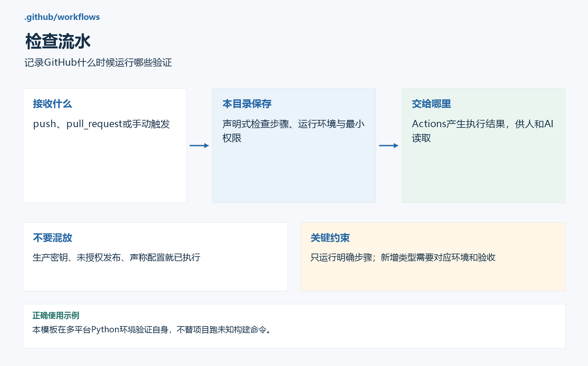

# .github/workflows｜检查流水

记录GitHub什么时候运行哪些验证。

## 什么时候来这里

当你需要处理“push、pull_request或手动触发”时，从这里找到对应规则或维护位置。

## 收什么、存什么、交给谁

| 问题 | 具体说明 |
| --- | --- |
| 输入来自哪里 | push、pull_request或手动触发 |
| 本目录保存什么 | 声明式检查步骤、运行环境与最小权限 |
| 产出交给哪里 | Actions产生执行结果，供人和AI读取 |
| 不应放什么 | 生产密钥、未授权发布、声称配置就已执行 |
| 必须遵守 | 只运行明确步骤；新增类型需要对应环境和验收 |

## 一次正确使用

本模板在多平台Python环境验证自身，不替项目跑未知构建命令。

先明确这是原始输入、已确认事实、需求定义、计划还是实际结果，再选择文件位置。若已有唯一维护位置，新增材料引用它，不复制一份持续更新的状态。

## 与其他部分的关系

- [工作空间总说明](../../README.md)解释完整地图和第一次使用方式。
- [完整流程指南](../../00-rules/guides/workflow.md)解释如何从反馈走到交付，再开始下一轮。
- [唯一事实源规则](../../00-rules/source-of-truth.md)解决两份文档冲突。
- [AI协作入口](../../AGENTS.md)约束AI的执行与确认边界。

本仓库是通用模板；本目录没有真实产品需求、真实部署或实际客户资料。读完说明不代表相关动作已执行。
