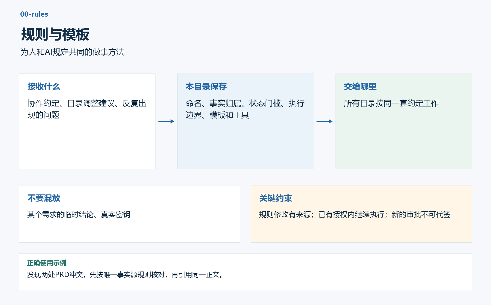

# 00-rules｜规则与模板

为人和AI规定共同的做事方法。

## 什么时候来这里

当你需要处理“协作约定、目录调整建议、反复出现的问题”时，从这里找到对应规则或维护位置。

## 收什么、存什么、交给谁

| 问题 | 具体说明 |
| --- | --- |
| 输入来自哪里 | 协作约定、目录调整建议、反复出现的问题 |
| 本目录保存什么 | 命名、事实归属、状态门槛、执行边界、模板和工具 |
| 产出交给哪里 | 所有目录按同一套约定工作 |
| 不应放什么 | 某个需求的临时结论、真实密钥 |
| 必须遵守 | 规则修改有来源；已有授权内继续执行；新的审批不可代签 |

## 一次正确使用

发现两处PRD冲突，先按唯一事实源规则核对，再引用同一正文。

先明确这是原始输入、已确认事实、需求定义、计划还是实际结果，再选择文件位置。若已有唯一维护位置，新增材料引用它，不复制一份持续更新的状态。

## 与其他部分的关系

- [工作空间总说明](../README.md)解释完整地图和第一次使用方式。
- [完整流程指南](guides/workflow.md)解释如何从反馈走到交付，再开始下一轮。
- [唯一事实源规则](source-of-truth.md)解决两份文档冲突。
- [AI协作入口](../AGENTS.md)约束AI的执行与确认边界。

本仓库是通用模板；本目录没有真实产品需求、真实部署或实际客户资料。读完说明不代表相关动作已执行。
