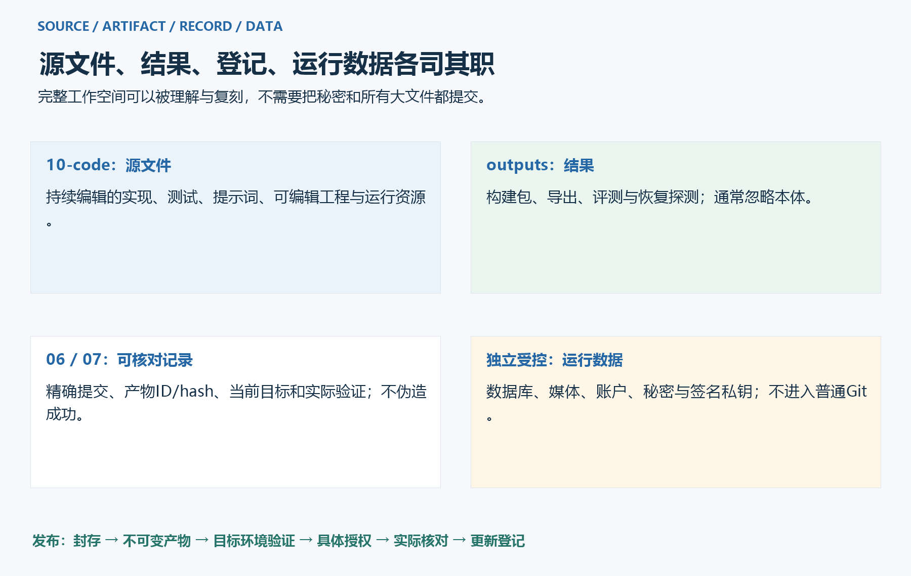

# 工程、产物、部署与数据

| 类型 | 工程源文件 | 真正的交付/运行验证 |
| --- | --- | --- |
| 网站/API | 页面、接口、测试、配置 | 预发布及生产访问、权限、API与持久化 |
| 手机/桌面App | 工程、资源、打包脚本 | 安装、签名、升级、权限和回退 |
| 插件/CLI/SDK | 实现、契约、示例与测试 | 宿主加载或目标环境中的实际调用 |
| Agent/自动化 | 提示词源、工具、工作流与评测 | 已授权环境执行、评测、成本与恢复 |
| 内容/设计工程 | 可编辑工程、模板与脚本 | 实际导出文件、可读性、媒体质量和交付 |

源文件在10-code；框架必需资源服从工程路径。outputs保存发布包、评测和导出，框架生成目录按原约定使用。大文件本体通常忽略，Git中保存产物收据：ID、用途、类型、组件/版本、精确源码提交、SHA-256、字节数、访问级别、存储引用与验证范围。

环境身份和配置变量名称在02-product/environments；当前实际运行版本在deployment-register；本版计划在06-versions/版本/deployment-plan；每次尝试及回退结果在07-reviews。没有创建环境或部署时保持空表，不预填假域名或“已发布”。

发布主线：需求批准→开发测试→封存→不可变产物→预发布/目标环境验证→具体授权→发布或安装→真实核对→更新登记→复盘。尽量提升同一验证产物；必须重建时记录提交、锁文件、环境差异和生产核对。首次发布无旧版时明确撤下或修复路线。

失败且确认没有切换，保留原部署指针；可能切换但查不到结果，标待核对并保留最后已知信息。回退验证后登记实际恢复目标，不能抹去失败部署历史。

秘密值放受控秘密系统；本地.env忽略，.env.example只放无秘密示例。浏览器和静态产物中的变量可能公开，不得放服务端秘密。签名私钥、生产数据库、对象存储和真实媒体不进入普通Git。

GitHub Actions可执行已配置步骤，但现有模板只验证自身。不能把通用Python CI当成已覆盖iOS、Android或任意框架；新增组件需明确运行环境、锁文件、可用Runner、测试、产物、签名权限和回退条件。生产发布要另有授权，不因模板存在默认执行。
