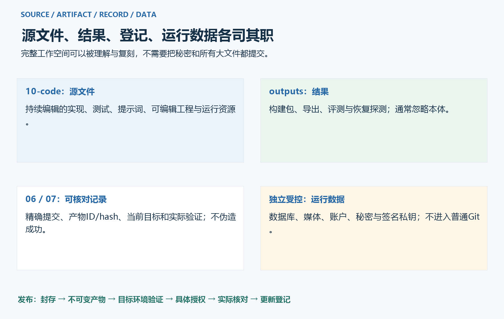

# 发布、部署、安装与GitHub分发

## Git里放什么

规则、PRD、源码、测试、锁文件、无秘密配置、版本计划和结果收据适合版本化。依赖、缓存、安装包、数据库、真实媒体和完整备份通常另存，Git里保留可分享的元数据。所有README相对链接应在干净克隆可访问，不能指向被忽略的本机私有文件。

## 公开前

从独立空目录构建将公开的内容，不继承无关产品历史。检查所有提交及文件，不只看当前工作树；确认秘密、个人资料、账户、未授权材料和业务代码没有混入。区分这个通用模板的MIT许可和以后加入项目、第三方素材或依赖的许可。

## 产物收据

记录真实生成的文件或平台产物：ID、类型、组件、版本/commit、hash、字节数、存储与访问级别、来源及验证范围。local-only就写local-only；不要填虚构远端URL。实际payload缺席时，收据仍能让别人理解怎样取得与验证。

## 一次真实发布

版本scope引用已确认范围；deployment-plan列目标、命令、依赖、环境变量名称、备份和停止/回退条件。实际执行写deployment-result并区分构建、上传、服务可用和业务验收。核对真实目标后更新当前部署登记。

签名、域名、证书、缓存、数据库迁移与外部服务按项目实际情况检查。不同平台操作不同，模板不提供一个“运行就部署全部项目”的危险按钮。

## GitHub能力

GitHub模板仓库能让使用者复制同一结构；它不等于已有业务工程。Actions当前只检查通用模板和工具；远端分支保护、环境审批和秘密管理是否可用取决于真实仓库及账号配置，应另行核对。

发行安装包可使用Release或其他适当存储，需留标签、来源和hash；大素材若采用LFS需核对实际对象保管，不只保存指针。不要以“上传整个工作空间”为由把所有本机产物都提交。

官方参考见CITATION.md；本模板不自动创建GitHub远端，也不要求使用者必须公开产品。
