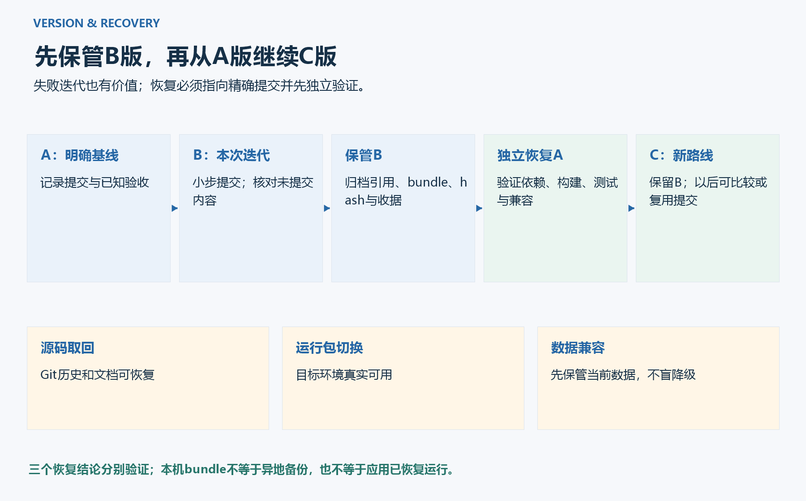

# 保管、返回旧版与复用失败尝试

## 哪些记录在哪里

需求状态在需求池；源码保管点在06-versions/checkpoint-register；产物在artifact-register及收据；回退理由、动作和实际恢复结果在07-reviews。Git提交、分支和标签保存源码与已提交文档的版本关系。

## 一次可靠封存

先核对工作目录，包括未暂存、未跟踪和被忽略文件。审查后保存需保留的实现和文档；不要无差别git add。保留当前迭代引用，创建bundle，检查hash，在独立目录克隆并核对提交与源码树；工具成功后登记收据。

本模板checkpoint.py默认要求干净根Git，拒绝把未提交内容静默漏掉。它保管根Git可达历史，拒绝未定义的LFS或子模块payload范围。它不保存生产数据库、秘密、被忽略文件和已安装应用。

## 需要返回A版时

先保存现在的B版；明确A的提交或标签及已知验收。独立取回A，检查依赖与构建测试；需要实际切服务时再按授权处理安装、部署和数据兼容。切换后仍保留B的归档引用和收据。

不要默认强制reset、clean或删除分支；共享主线通过可审查撤销提交保留事件。旧布局和旧数据库都可能与现在不同，不能拿旧源码目录直接覆盖当前根工作空间。

## 以后又想用B版

先比较差异，可从归档引用新开分支继续，也可挑选某些提交复用。复用后重新检查依赖和验收，不能把B当时的测试直接当作新版本通过。

## 备份的边界

本机Git和同盘bundle不防整盘损坏；重要点需另外保管到用户认可的私有远端或设备。公开GitHub仓库不适合承载客户数据或秘密。标签固定某个提交，不代表依赖源永远可下载；真正长期可运行恢复还需产物和环境验证。

清理旧迭代前明确对象、引用、替代保管点和批准。默认不自动按天数删除用户以后可能复用的代码。
