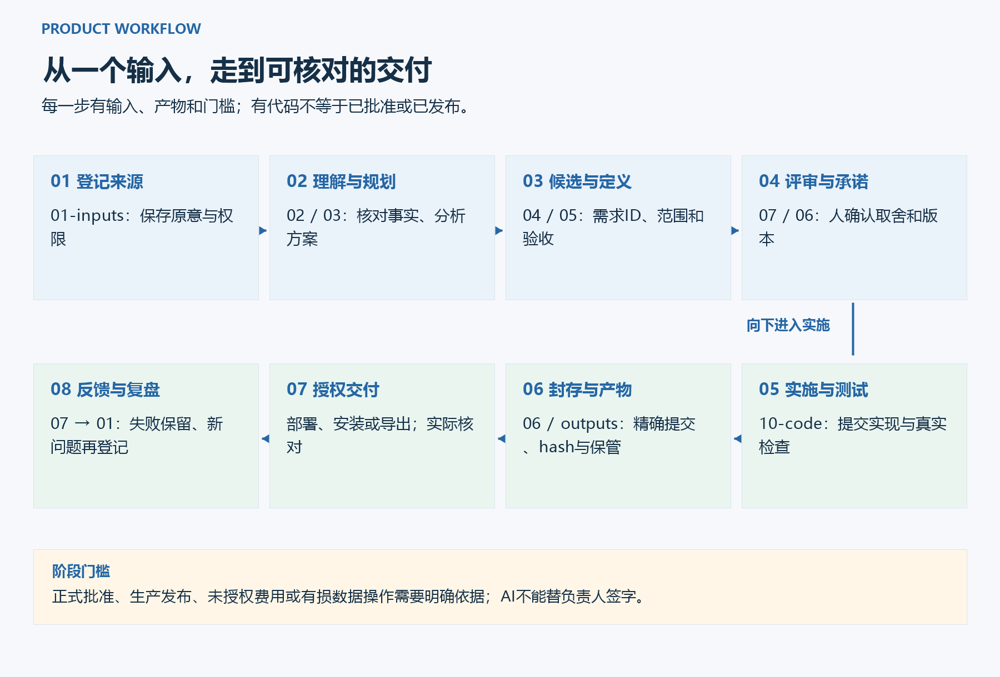

# 从输入到复盘：完整工作流

## 1 收集：01-inputs

把用户说的话、观察、图片、资料和历史文档分开登记。保留原意、来源、日期、访问权限与版本。AI可以总结，但总结不能悄悄覆盖原文。问题不明确时先列待确认，不急着创建开发任务。

## 2 认识产品：02-product

澄清谁在什么场景遇到什么问题，当前系统有什么能力和限制。市场分析、用户研究需要真实来源；没有调查就写未覆盖。稳定结论经确认后放产品背景，多个需求共用的术语也在这里维护。

## 3 分析与取舍：03-planning

分析候选方案、模块、依赖、风险和投入。决定应说明依据和放弃理由。路线图是方向，scope才是版本承诺。不要因为AI能快速生成方案，就把所有方案都排进开发。

## 4 候选与定义：04和05

需求池分配ID和当前状态。独立工作包写用户问题、目标、范围、非目标、入口、流程、数据、权限、异常、恢复与可观察验收。不要将技术实现细节全部塞进用户操作说明；实施方案单独引用。

## 5 评审与版本承诺：07和06

评审指出待决事项，负责人确认后才批准。变更批准范围要留下原因并返回评审。版本目录引用REQ清单、依赖、里程碑、验证和回退方案；不复制整份PRD，也不把全需求池当版本计划。

## 6 实施与验证：10-code及Git

选择已登记组件，在独立迭代分支小步提交。执行相应测试并保留结果。代码完成可能仍缺真实模型、设备、宿主或用户验收，不能凭本地夹具标上线。修改一处需求后核对关联文档、测试和接口。

## 7 保管与交付：06、07和outputs

交付前保存精确源码和当时文档，保留产物ID/hash/来源。网站部署、App安装、插件加载、CLI调用或媒体导出按真实类型验收。涉及生产、费用、外传或数据迁移时确认具体范围；已有明确授权不反复问同一动作。

## 8 反馈重新进入输入

保留实际效果、失败和用户反馈，不抹去被放弃版本。需求是否关闭由负责人确认，遗留项重新登记来源和候选需求。不要把“复盘完成”写成所有问题已经解决。

## 人和AI的交接单位

每次交接至少包含REQ/版本、当前目标、唯一PRD、已知基线、允许动作、执行证据、未覆盖及下一步。只说“继续上次”会增加猜测；让AI先读取记录，再执行明确范围。
