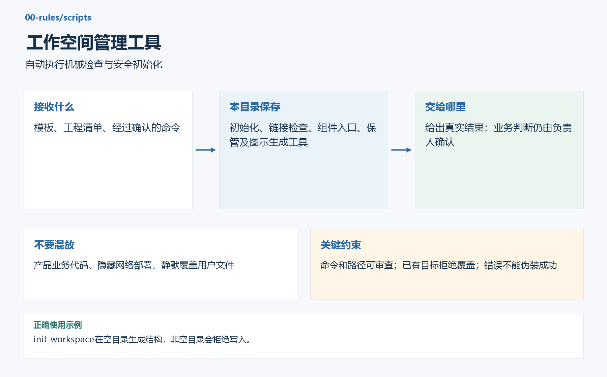

# 00-rules/scripts｜工作空间管理工具

自动执行机械检查与安全初始化。

## 什么时候来这里

当你需要处理“模板、工程清单、经过确认的命令”时，从这里找到对应规则或维护位置。

## 收什么、存什么、交给谁

| 问题 | 具体说明 |
| --- | --- |
| 输入来自哪里 | 模板、工程清单、经过确认的命令 |
| 本目录保存什么 | 初始化、链接检查、组件入口、保管及图示生成工具 |
| 产出交给哪里 | 给出真实结果；业务判断仍由负责人确认 |
| 不应放什么 | 产品业务代码、隐藏网络部署、静默覆盖用户文件 |
| 必须遵守 | 命令和路径可审查；已有目标拒绝覆盖；错误不能伪装成功 |

## 一次正确使用

init_workspace在空目录生成结构，非空目录会拒绝写入。

先明确这是原始输入、已确认事实、需求定义、计划还是实际结果，再选择文件位置。若已有唯一维护位置，新增材料引用它，不复制一份持续更新的状态。

## 与其他部分的关系

- [工作空间总说明](../../README.md)解释完整地图和第一次使用方式。
- [完整流程指南](../guides/workflow.md)解释如何从反馈走到交付，再开始下一轮。
- [唯一事实源规则](../source-of-truth.md)解决两份文档冲突。
- [AI协作入口](../../AGENTS.md)约束AI的执行与确认边界。

本仓库是通用模板；本目录没有真实产品需求、真实部署或实际客户资料。读完说明不代表相关动作已执行。
