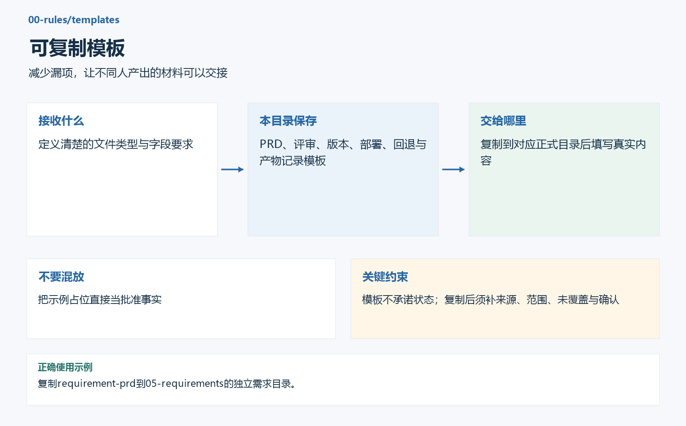

# 00-rules/templates｜可复制模板

减少漏项，让不同人产出的材料可以交接。

## 什么时候来这里

当你需要处理“定义清楚的文件类型与字段要求”时，从这里找到对应规则或维护位置。

## 收什么、存什么、交给谁

| 问题 | 具体说明 |
| --- | --- |
| 输入来自哪里 | 定义清楚的文件类型与字段要求 |
| 本目录保存什么 | PRD、评审、版本、部署、回退与产物记录模板 |
| 产出交给哪里 | 复制到对应正式目录后填写真实内容 |
| 不应放什么 | 把示例占位直接当批准事实 |
| 必须遵守 | 模板不承诺状态；复制后须补来源、范围、未覆盖与确认 |

## 一次正确使用

复制requirement-prd到05-requirements的独立需求目录。

先明确这是原始输入、已确认事实、需求定义、计划还是实际结果，再选择文件位置。若已有唯一维护位置，新增材料引用它，不复制一份持续更新的状态。

## 与其他部分的关系

- [工作空间总说明](../../README.md)解释完整地图和第一次使用方式。
- [完整流程指南](../guides/workflow.md)解释如何从反馈走到交付，再开始下一轮。
- [唯一事实源规则](../source-of-truth.md)解决两份文档冲突。
- [AI协作入口](../../AGENTS.md)约束AI的执行与确认边界。

本仓库是通用模板；本目录没有真实产品需求、真实部署或实际客户资料。读完说明不代表相关动作已执行。
