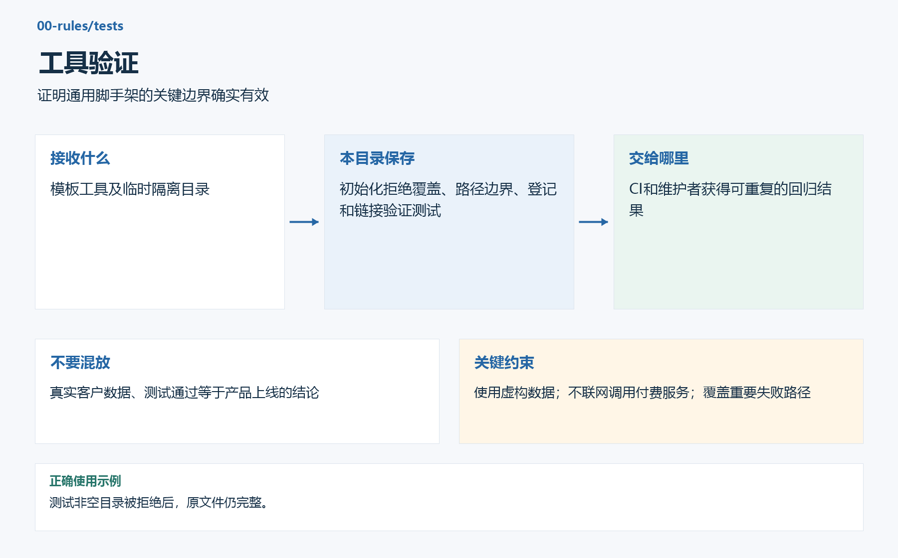

# 00-rules/tests｜工具验证

证明通用脚手架的关键边界确实有效。

## 什么时候来这里

当你需要处理“模板工具及临时隔离目录”时，从这里找到对应规则或维护位置。

## 收什么、存什么、交给谁

| 问题 | 具体说明 |
| --- | --- |
| 输入来自哪里 | 模板工具及临时隔离目录 |
| 本目录保存什么 | 初始化拒绝覆盖、路径边界、登记和链接验证测试 |
| 产出交给哪里 | CI和维护者获得可重复的回归结果 |
| 不应放什么 | 真实客户数据、测试通过等于产品上线的结论 |
| 必须遵守 | 使用虚构数据；不联网调用付费服务；覆盖重要失败路径 |

## 一次正确使用

测试非空目录被拒绝后，原文件仍完整。

先明确这是原始输入、已确认事实、需求定义、计划还是实际结果，再选择文件位置。若已有唯一维护位置，新增材料引用它，不复制一份持续更新的状态。

## 与其他部分的关系

- [工作空间总说明](../../README.md)解释完整地图和第一次使用方式。
- [完整流程指南](../guides/workflow.md)解释如何从反馈走到交付，再开始下一轮。
- [唯一事实源规则](../source-of-truth.md)解决两份文档冲突。
- [AI协作入口](../../AGENTS.md)约束AI的执行与确认边界。

本仓库是通用模板；本目录没有真实产品需求、真实部署或实际客户资料。读完说明不代表相关动作已执行。
