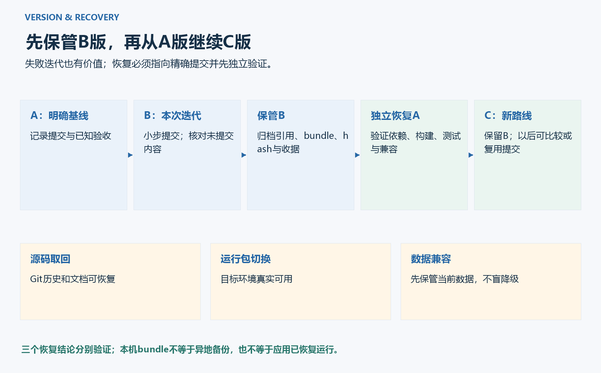

# 版本留存、放弃迭代与恢复

默认使用根Git同步保存已提交的工程和管理文档。main是集成主线，不自动等于稳定运行版。iter/req-0001-short-name表示一次迭代；archive/日期-迭代名保留被放弃或回退前的提交；checkpoint/日期-ID只代表保管点；真实验证及确认后才使用release/v版本发布标签。

每轮开始记录基线提交和已知可运行版；开发中小步提交；准备放弃或回退前，先核对暂存、未暂存、未跟踪及被忽略内容。经审查将需保留源码和文档保存为提交或独立受控备份，保留归档引用，再生成完整bundle及收据。stash可临时用，不能是唯一长期保管点。

例如A版→开发B版→B版不满意：保管B版并记录原因；从精确A提交建立新路线C；未来通过比较、cherry-pick或合并复用B的部分内容。失败迭代保留，不自动删分支，不自动把需求closed。

恢复时优先在独立目录验证：提交和源码树、依赖、构建、测试，再决定是否切实际运行目标。已共享主线通常用新的revert提交保留撤销过程；不得默认reset --hard、clean -fd、强推或删除归档。发布标签和已封存引用不覆盖复用。

Git不包括未提交和忽略文件，也不保证依赖源永久可下载。LFS和子模块payload须额外核对；本工具遇到它们会拒绝给出完整保管承诺。密钥、数据库、用户媒体、已安装运行环境分别保管，不能塞进普通源码bundle。

源码能取回、安装包能切回、数据库能兼容是三件事。恢复旧数据前先保管当前新数据，在独立目标验证，不覆盖唯一当前数据，不自动执行有损schema逆迁移。没有稳定基线就如实写未建立。

本地完整bundle加独立克隆可防部分误操作，不能防整盘损坏。重要版本另存用户认可的私有远端或其他设备，上传范围与凭据先核对。清理历史须明确授权并验证替代保管点，默认长期保留发布点及失败迭代最后版本。

每次封存成功后登记checkpoint-register；回退过程写07-reviews；工具只证明Git对象能恢复，不自动证明真实应用可运行。
