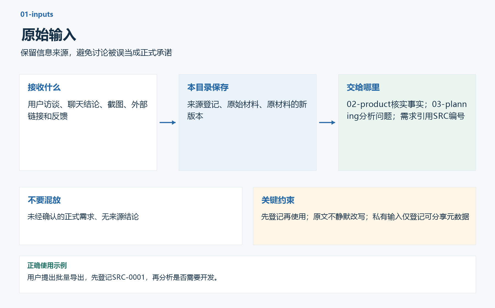

# 01-inputs｜原始输入

保留信息来源，避免讨论被误当成正式承诺。

## 什么时候来这里

当你需要处理“用户访谈、聊天结论、截图、外部链接和反馈”时，从这里找到对应规则或维护位置。

## 收什么、存什么、交给谁

| 问题 | 具体说明 |
| --- | --- |
| 输入来自哪里 | 用户访谈、聊天结论、截图、外部链接和反馈 |
| 本目录保存什么 | 来源登记、原始材料、原材料的新版本 |
| 产出交给哪里 | 02-product核实事实；03-planning分析问题；需求引用SRC编号 |
| 不应放什么 | 未经确认的正式需求、无来源结论 |
| 必须遵守 | 先登记再使用；原文不静默改写；私有输入仅登记可分享元数据 |

## 一次正确使用

用户提出批量导出，先登记SRC-0001，再分析是否需要开发。

先明确这是原始输入、已确认事实、需求定义、计划还是实际结果，再选择文件位置。若已有唯一维护位置，新增材料引用它，不复制一份持续更新的状态。

## 与其他部分的关系

- [工作空间总说明](../README.md)解释完整地图和第一次使用方式。
- [完整流程指南](../00-rules/guides/workflow.md)解释如何从反馈走到交付，再开始下一轮。
- [唯一事实源规则](../00-rules/source-of-truth.md)解决两份文档冲突。
- [AI协作入口](../AGENTS.md)约束AI的执行与确认边界。

本仓库是通用模板；本目录没有真实产品需求、真实部署或实际客户资料。读完说明不代表相关动作已执行。
