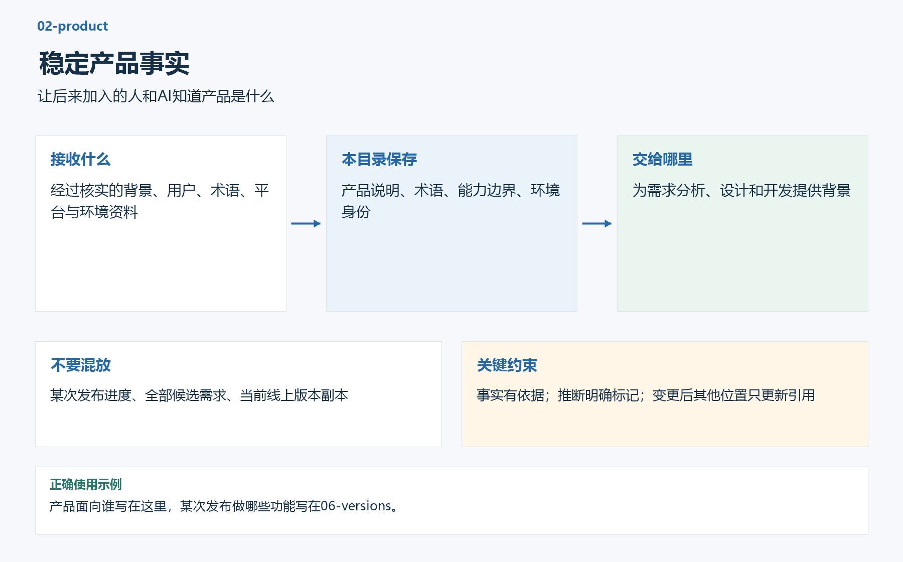

# 02-product｜稳定产品事实

让后来加入的人和AI知道产品是什么。

## 什么时候来这里

当你需要处理“经过核实的背景、用户、术语、平台与环境资料”时，从这里找到对应规则或维护位置。

## 收什么、存什么、交给谁

| 问题 | 具体说明 |
| --- | --- |
| 输入来自哪里 | 经过核实的背景、用户、术语、平台与环境资料 |
| 本目录保存什么 | 产品说明、术语、能力边界、环境身份 |
| 产出交给哪里 | 为需求分析、设计和开发提供背景 |
| 不应放什么 | 某次发布进度、全部候选需求、当前线上版本副本 |
| 必须遵守 | 事实有依据；推断明确标记；变更后其他位置只更新引用 |

## 一次正确使用

产品面向谁写在这里，某次发布做哪些功能写在06-versions。

先明确这是原始输入、已确认事实、需求定义、计划还是实际结果，再选择文件位置。若已有唯一维护位置，新增材料引用它，不复制一份持续更新的状态。

## 与其他部分的关系

- [工作空间总说明](../README.md)解释完整地图和第一次使用方式。
- [完整流程指南](../00-rules/guides/workflow.md)解释如何从反馈走到交付，再开始下一轮。
- [唯一事实源规则](../00-rules/source-of-truth.md)解决两份文档冲突。
- [AI协作入口](../AGENTS.md)约束AI的执行与确认边界。

本仓库是通用模板；本目录没有真实产品需求、真实部署或实际客户资料。读完说明不代表相关动作已执行。
