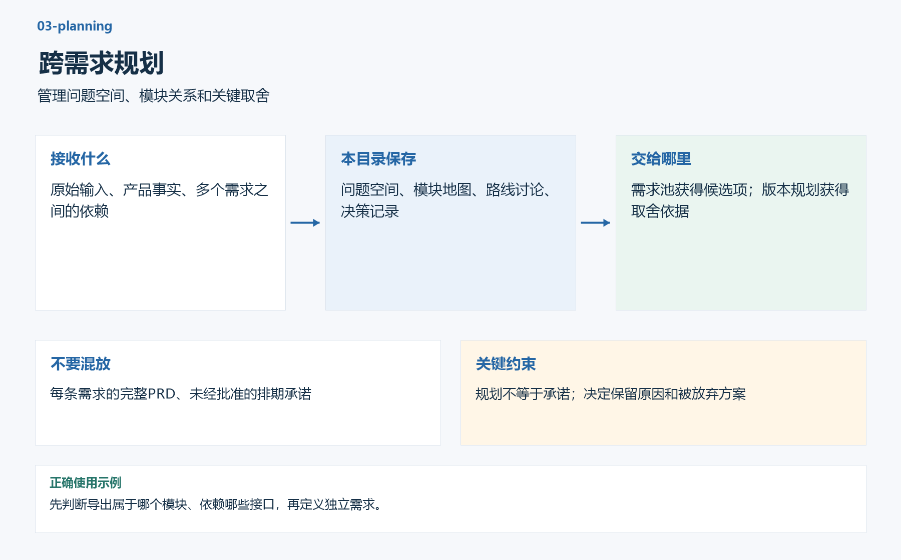

# 03-planning｜跨需求规划

管理问题空间、模块关系和关键取舍。

## 什么时候来这里

当你需要处理“原始输入、产品事实、多个需求之间的依赖”时，从这里找到对应规则或维护位置。

## 收什么、存什么、交给谁

| 问题 | 具体说明 |
| --- | --- |
| 输入来自哪里 | 原始输入、产品事实、多个需求之间的依赖 |
| 本目录保存什么 | 问题空间、模块地图、路线讨论、决策记录 |
| 产出交给哪里 | 需求池获得候选项；版本规划获得取舍依据 |
| 不应放什么 | 每条需求的完整PRD、未经批准的排期承诺 |
| 必须遵守 | 规划不等于承诺；决定保留原因和被放弃方案 |

## 一次正确使用

先判断导出属于哪个模块、依赖哪些接口，再定义独立需求。

先明确这是原始输入、已确认事实、需求定义、计划还是实际结果，再选择文件位置。若已有唯一维护位置，新增材料引用它，不复制一份持续更新的状态。

## 与其他部分的关系

- [工作空间总说明](../README.md)解释完整地图和第一次使用方式。
- [完整流程指南](../00-rules/guides/workflow.md)解释如何从反馈走到交付，再开始下一轮。
- [唯一事实源规则](../00-rules/source-of-truth.md)解决两份文档冲突。
- [AI协作入口](../AGENTS.md)约束AI的执行与确认边界。

本仓库是通用模板；本目录没有真实产品需求、真实部署或实际客户资料。读完说明不代表相关动作已执行。
