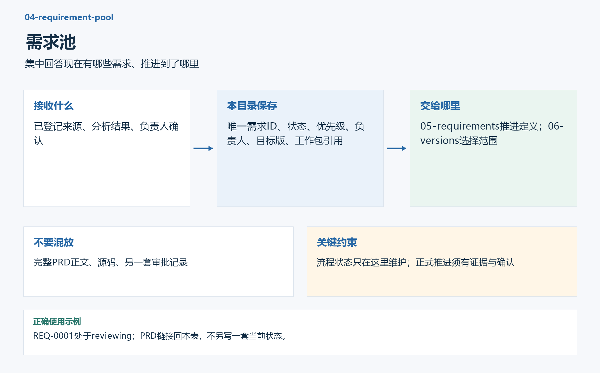

# 04-requirement-pool｜需求池

集中回答现在有哪些需求、推进到了哪里。

## 什么时候来这里

当你需要处理“已登记来源、分析结果、负责人确认”时，从这里找到对应规则或维护位置。

## 收什么、存什么、交给谁

| 问题 | 具体说明 |
| --- | --- |
| 输入来自哪里 | 已登记来源、分析结果、负责人确认 |
| 本目录保存什么 | 唯一需求ID、状态、优先级、负责人、目标版、工作包引用 |
| 产出交给哪里 | 05-requirements推进定义；06-versions选择范围 |
| 不应放什么 | 完整PRD正文、源码、另一套审批记录 |
| 必须遵守 | 流程状态只在这里维护；正式推进须有证据与确认 |

## 一次正确使用

REQ-0001处于reviewing；PRD链接回本表，不另写一套当前状态。

先明确这是原始输入、已确认事实、需求定义、计划还是实际结果，再选择文件位置。若已有唯一维护位置，新增材料引用它，不复制一份持续更新的状态。

## 与其他部分的关系

- [工作空间总说明](../README.md)解释完整地图和第一次使用方式。
- [完整流程指南](../00-rules/guides/workflow.md)解释如何从反馈走到交付，再开始下一轮。
- [唯一事实源规则](../00-rules/source-of-truth.md)解决两份文档冲突。
- [AI协作入口](../AGENTS.md)约束AI的执行与确认边界。

本仓库是通用模板；本目录没有真实产品需求、真实部署或实际客户资料。读完说明不代表相关动作已执行。
