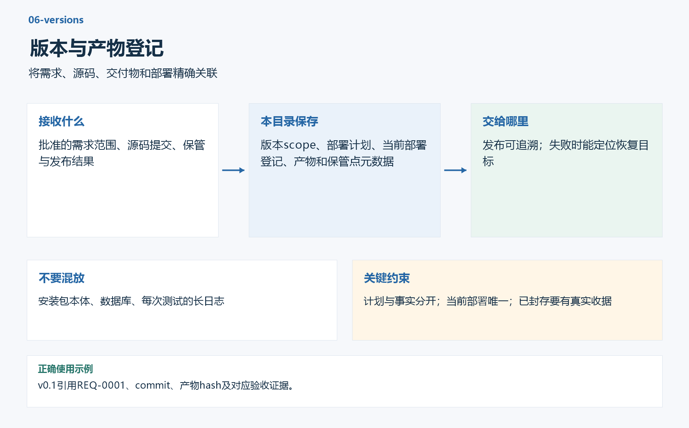

# 06-versions｜版本与产物登记

将需求、源码、交付物和部署精确关联。

## 什么时候来这里

当你需要处理“批准的需求范围、源码提交、保管与发布结果”时，从这里找到对应规则或维护位置。

## 收什么、存什么、交给谁

| 问题 | 具体说明 |
| --- | --- |
| 输入来自哪里 | 批准的需求范围、源码提交、保管与发布结果 |
| 本目录保存什么 | 版本scope、部署计划、当前部署登记、产物和保管点元数据 |
| 产出交给哪里 | 发布可追溯；失败时能定位恢复目标 |
| 不应放什么 | 安装包本体、数据库、每次测试的长日志 |
| 必须遵守 | 计划与事实分开；当前部署唯一；已封存要有真实收据 |

## 一次正确使用

v0.1引用REQ-0001、commit、产物hash及对应验收证据。

先明确这是原始输入、已确认事实、需求定义、计划还是实际结果，再选择文件位置。若已有唯一维护位置，新增材料引用它，不复制一份持续更新的状态。

## 与其他部分的关系

- [工作空间总说明](../README.md)解释完整地图和第一次使用方式。
- [完整流程指南](../00-rules/guides/workflow.md)解释如何从反馈走到交付，再开始下一轮。
- [唯一事实源规则](../00-rules/source-of-truth.md)解决两份文档冲突。
- [AI协作入口](../AGENTS.md)约束AI的执行与确认边界。

本仓库是通用模板；本目录没有真实产品需求、真实部署或实际客户资料。读完说明不代表相关动作已执行。
