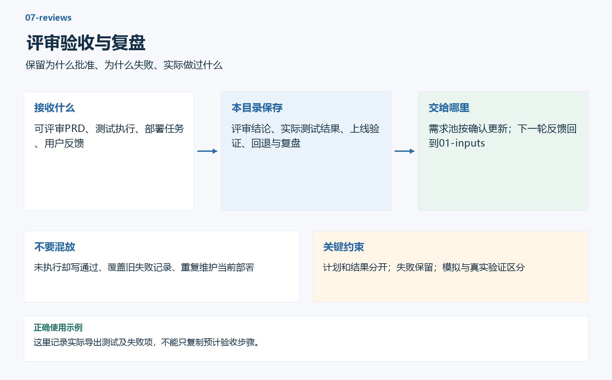

# 07-reviews｜评审验收与复盘

保留为什么批准、为什么失败、实际做过什么。

## 什么时候来这里

当你需要处理“可评审PRD、测试执行、部署任务、用户反馈”时，从这里找到对应规则或维护位置。

## 收什么、存什么、交给谁

| 问题 | 具体说明 |
| --- | --- |
| 输入来自哪里 | 可评审PRD、测试执行、部署任务、用户反馈 |
| 本目录保存什么 | 评审结论、实际测试结果、上线验证、回退与复盘 |
| 产出交给哪里 | 需求池按确认更新；下一轮反馈回到01-inputs |
| 不应放什么 | 未执行却写通过、覆盖旧失败记录、重复维护当前部署 |
| 必须遵守 | 计划和结果分开；失败保留；模拟与真实验证区分 |

## 一次正确使用

这里记录实际导出测试及失败项，不能只复制预计验收步骤。

先明确这是原始输入、已确认事实、需求定义、计划还是实际结果，再选择文件位置。若已有唯一维护位置，新增材料引用它，不复制一份持续更新的状态。

## 与其他部分的关系

- [工作空间总说明](../README.md)解释完整地图和第一次使用方式。
- [完整流程指南](../00-rules/guides/workflow.md)解释如何从反馈走到交付，再开始下一轮。
- [唯一事实源规则](../00-rules/source-of-truth.md)解决两份文档冲突。
- [AI协作入口](../AGENTS.md)约束AI的执行与确认边界。

本仓库是通用模板；本目录没有真实产品需求、真实部署或实际客户资料。读完说明不代表相关动作已执行。
