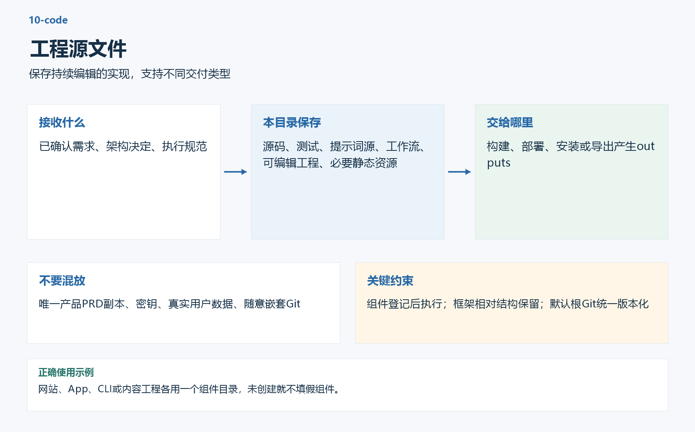

# 10-code｜工程源文件

保存持续编辑的实现，支持不同交付类型。

## 什么时候来这里

当你需要处理“已确认需求、架构决定、执行规范”时，从这里找到对应规则或维护位置。

## 收什么、存什么、交给谁

| 问题 | 具体说明 |
| --- | --- |
| 输入来自哪里 | 已确认需求、架构决定、执行规范 |
| 本目录保存什么 | 源码、测试、提示词源、工作流、可编辑工程、必要静态资源 |
| 产出交给哪里 | 构建、部署、安装或导出产生outputs |
| 不应放什么 | 唯一产品PRD副本、密钥、真实用户数据、随意嵌套Git |
| 必须遵守 | 组件登记后执行；框架相对结构保留；默认根Git统一版本化 |

## 一次正确使用

网站、App、CLI或内容工程各用一个组件目录，未创建就不填假组件。

先明确这是原始输入、已确认事实、需求定义、计划还是实际结果，再选择文件位置。若已有唯一维护位置，新增材料引用它，不复制一份持续更新的状态。

## 与其他部分的关系

- [工作空间总说明](../README.md)解释完整地图和第一次使用方式。
- [完整流程指南](../00-rules/guides/workflow.md)解释如何从反馈走到交付，再开始下一轮。
- [唯一事实源规则](../00-rules/source-of-truth.md)解决两份文档冲突。
- [AI协作入口](../AGENTS.md)约束AI的执行与确认边界。

本仓库是通用模板；本目录没有真实产品需求、真实部署或实际客户资料。读完说明不代表相关动作已执行。
