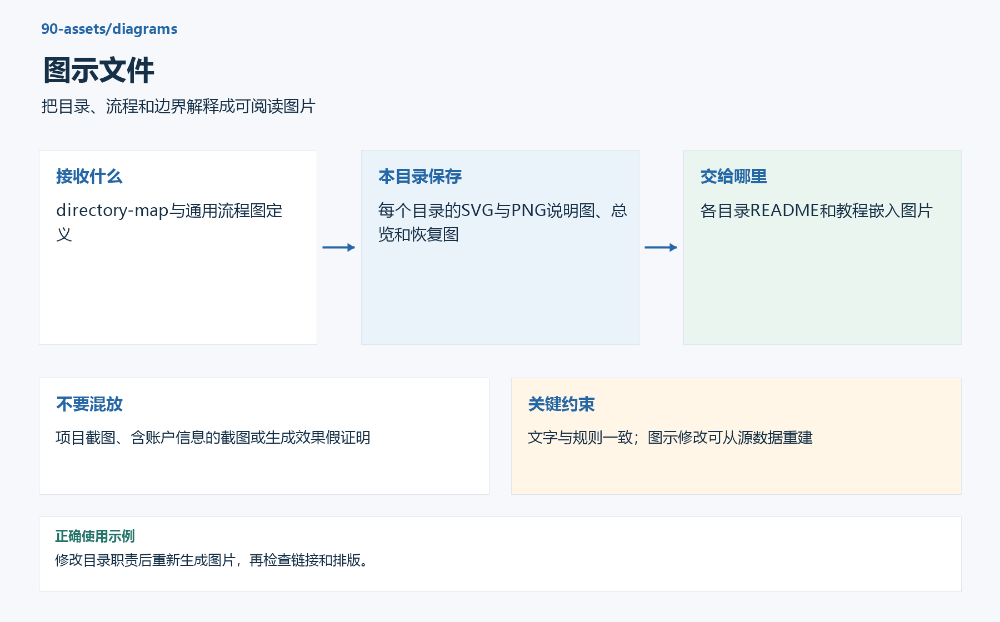

# 90-assets/diagrams｜图示文件

把目录、流程和边界解释成可阅读图片。



## 什么时候来这里

当你需要处理“directory-map与通用流程图定义”时，从这里找到对应规则或维护位置。

## 收什么、存什么、交给谁

| 问题 | 具体说明 |
| --- | --- |
| 输入来自哪里 | directory-map与通用流程图定义 |
| 本目录保存什么 | 每个目录的SVG与PNG说明图、总览和恢复图 |
| 产出交给哪里 | 各目录README和教程嵌入图片 |
| 不应放什么 | 项目截图、含账户信息的截图或生成效果假证明 |
| 必须遵守 | 文字与规则一致；图示修改可从源数据重建 |

## 一次正确使用

修改目录职责后重新生成图片，再检查链接和排版。

先明确这是原始输入、已确认事实、需求定义、计划还是实际结果，再选择文件位置。若已有唯一维护位置，新增材料引用它，不复制一份持续更新的状态。

## 与其他部分的关系

- [工作空间总说明](../../README.md)解释完整地图和第一次使用方式。
- [完整流程指南](../../00-rules/guides/workflow.md)解释如何从反馈走到交付，再开始下一轮。
- [唯一事实源规则](../../00-rules/source-of-truth.md)解决两份文档冲突。
- [AI协作入口](../../AGENTS.md)约束AI的执行与确认边界。

本仓库是通用模板；本目录没有真实产品需求、真实部署或实际客户资料。读完说明不代表相关动作已执行。

## 重建图示

PNG和SVG都随仓库提供，初始化不需要绘图库。目录图的文字源在00-rules/directory-map.json，通用图布局在render_diagrams.py。

```sh
python 00-rules/scripts/render_diagrams.py
```

以上仅用标准库生成SVG。Windows需要更新PNG时再运行：

```powershell
pwsh -File 00-rules/scripts/render_diagrams.ps1
```

PNG渲染使用系统中文字体，不打包字体文件；其他平台可使用已有SVG，或用自己的SVG栅格工具生成同名PNG并检查排版。改图后运行校验和工具测试。
