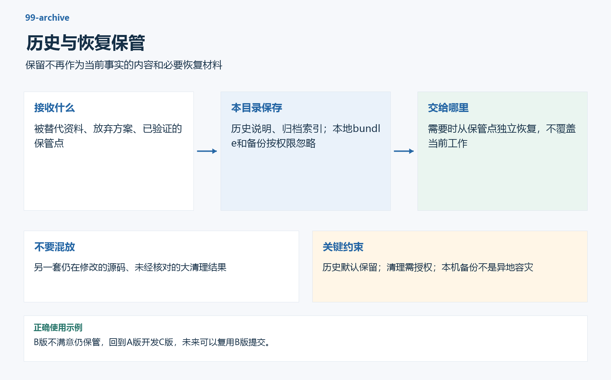

# 99-archive｜历史与恢复保管

保留不再作为当前事实的内容和必要恢复材料。

## 什么时候来这里

当你需要处理“被替代资料、放弃方案、已验证的保管点”时，从这里找到对应规则或维护位置。

## 收什么、存什么、交给谁

| 问题 | 具体说明 |
| --- | --- |
| 输入来自哪里 | 被替代资料、放弃方案、已验证的保管点 |
| 本目录保存什么 | 历史说明、归档索引；本地bundle和备份按权限忽略 |
| 产出交给哪里 | 需要时从保管点独立恢复，不覆盖当前工作 |
| 不应放什么 | 另一套仍在修改的源码、未经核对的大清理结果 |
| 必须遵守 | 历史默认保留；清理需授权；本机备份不是异地容灾 |

## 一次正确使用

B版不满意仍保管，回到A版开发C版，未来可以复用B版提交。

先明确这是原始输入、已确认事实、需求定义、计划还是实际结果，再选择文件位置。若已有唯一维护位置，新增材料引用它，不复制一份持续更新的状态。

## 与其他部分的关系

- [工作空间总说明](../README.md)解释完整地图和第一次使用方式。
- [完整流程指南](../00-rules/guides/workflow.md)解释如何从反馈走到交付，再开始下一轮。
- [唯一事实源规则](../00-rules/source-of-truth.md)解决两份文档冲突。
- [AI协作入口](../AGENTS.md)约束AI的执行与确认边界。

本仓库是通用模板；本目录没有真实产品需求、真实部署或实际客户资料。读完说明不代表相关动作已执行。
