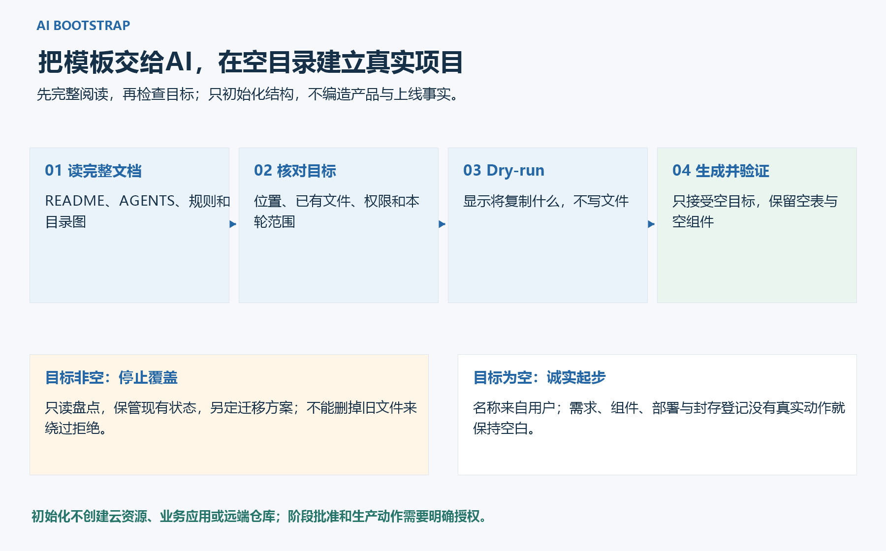

# 把这个仓库交给AI，复刻你的工作空间



下面的指令可以直接复制。把花括号里的项目参数换成真实信息，不提供密钥或账户密码。

```text
请使用AI-Product-Manager-workspace作为通用模板，为我的产品建立工作空间。

项目名称：{名称}
目标目录：{绝对路径或清楚的相对路径}
项目类型：{网站/App/服务/插件/CLI/SDK/Agent/内容工程，未知可留待确认}
已有材料：{文档、代码、反馈；没有就写没有}
已授权：{例如只初始化目录和通用规则}
本轮禁止：{例如不覆盖现有文件、不部署、不上传、不操作生产数据}

先完整阅读README、AGENTS和00-rules的核心规则，再输出目录判断与影响范围。
若目标目录非空，只读盘点并提出迁移计划，不直接覆盖或移动已有工程。
若目标不存在或为空，先dry-run，确认符合我已授权的范围后，用init_workspace.py生成。
保留原十个管理目录，10-code放工程源文件，outputs放结果，根Git统筹已提交文档与实现。
复制通用说明、模板、图示和工具；不要携带模板使用者的任何业务代码、真实需求、账号或Git历史。
不编造产品事实、需求批准、封存、部署或测试结果。初始组件和各登记表应为空。
执行后运行validate_workspace.py和工具测试，报告文件位置、实际结果、未覆盖和下一步。
未经本轮明确授权，不创建远端仓库、云资源、真实应用或生产部署。
```

## AI执行顺序

1. 识别目标是否为空，检查是否已有Git和未提交内容。路径含义不清楚时先询问，不能猜测删除。
2. 读取目录图和规则，核对本轮已授权范围。不要把教学案例导入为真实需求。
3. 新项目优先运行`init_workspace.py --dry-run`；目标安全且属于已授权范围才实际生成。
4. 仅替换项目名称、slug和项目入口信息，保留规则与模板。已有材料先登记来源，不直接升级为正式PRD。
5. 验证目录、链接、空表和工具；逐项说明实际做过什么。
6. 后续每轮从需求池和对应工作包接续，按规则取得阶段确认。

## 现有产品如何使用

不能把“克隆模板”理解为允许覆盖现有工作空间。先列源码根、Git边界、安装路径、运行数据、现有文档和引用，保管当前状态；在独立副本里改目录，验证后再切换。此模板的初始化工具会拒绝非空目录，这个拒绝不能用删除原文件来绕过。

## 完成判定

生成的新项目应有可读根README、AGENTS、原十目录、10-code、outputs、.github及工具；每个模板目录有配图。workspace.yaml为product模式，组件为空。校验通过，但不能声称已有真实产品、上线、发布或异地备份。

English handoff: Read the entire README and AGENTS first. Inspect the target. Refuse to overwrite an existing project. Dry-run the initializer, scaffold only into an empty target, preserve the directory contract, keep real registers empty, validate, and report actual outcomes. No deployment or remote publication is implied.
