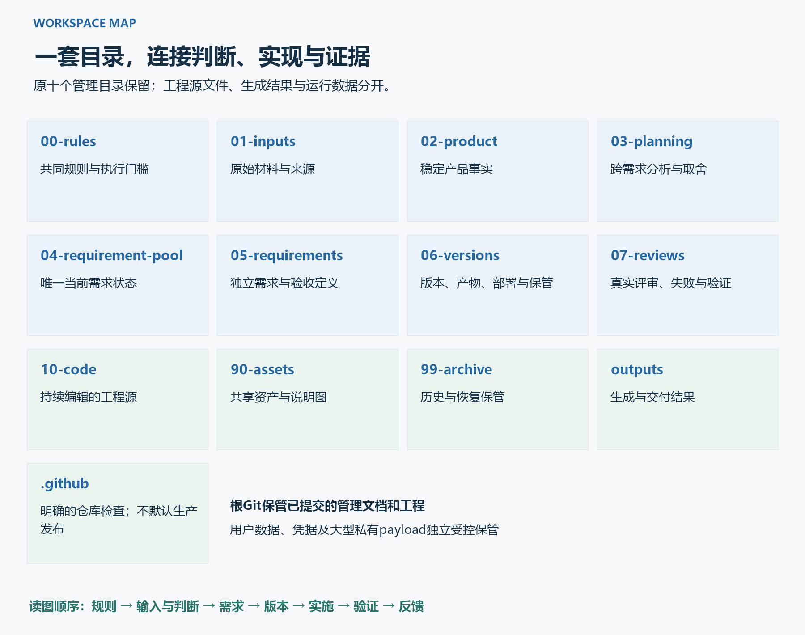
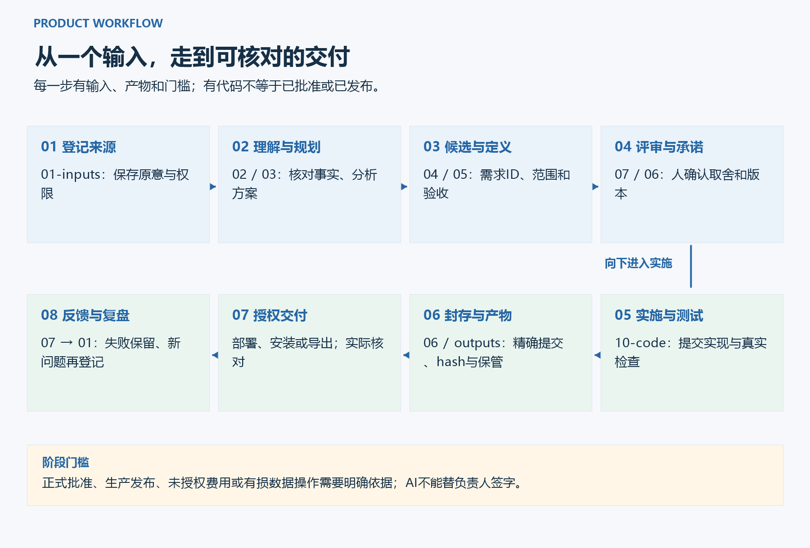
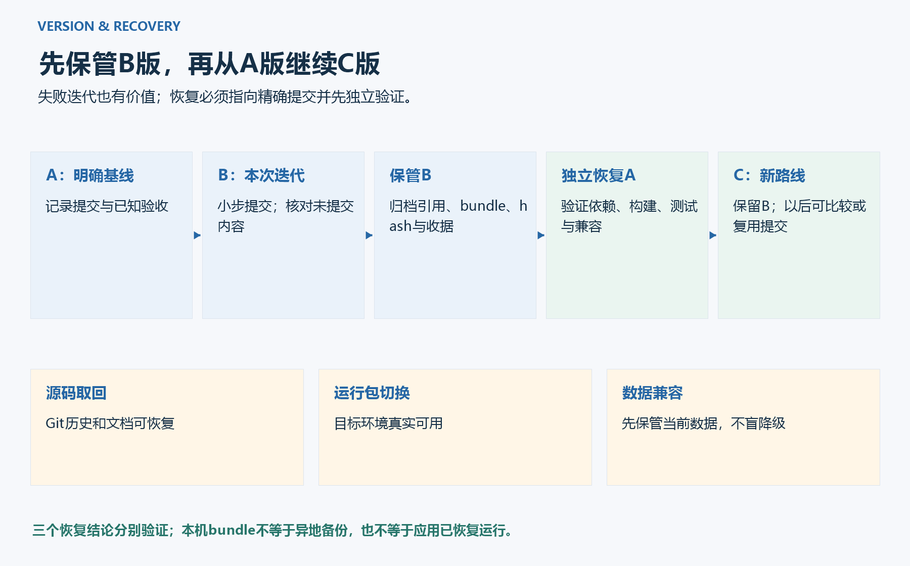
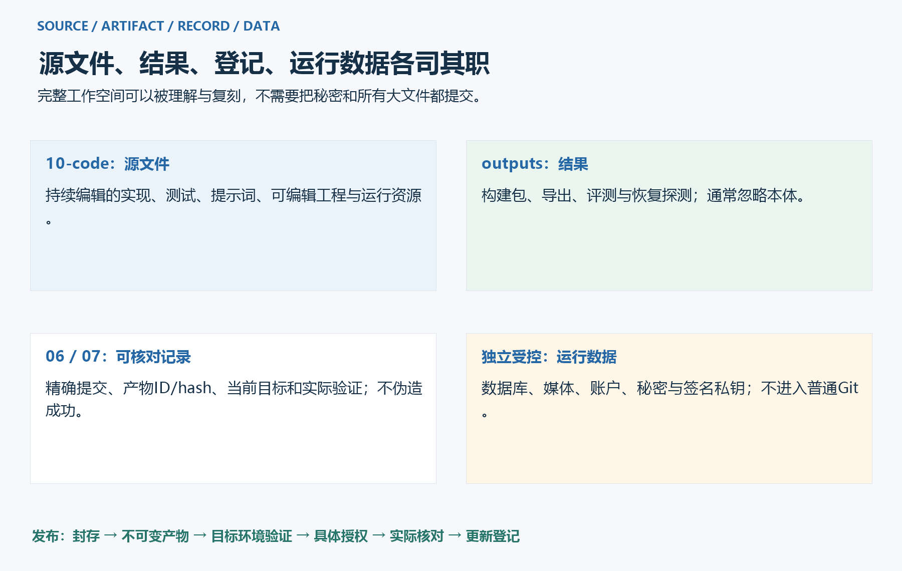

# AI-Product-Manager-workspace

**让人和AI在同一套可追溯的工作空间里，完成产品理解、需求、开发、交付与复盘。**

这是一套通用目录、规则、空白模板、说明图和管理工具。它不包含任何真实产品的业务代码、需求、截图、账号或历史。适用于网站、服务、App、插件、CLI、SDK、Agent及内容工程；不同类型共用管理流程，实施和验收按真实类型选择。



## 先用三句话理解

1. **管理目录回答为什么做、做什么、谁确认、验证过什么。** 原十个管理目录保留，以编号表示自然阅读顺序。
2. **10-code保存持续编辑的源文件，outputs保存生成结果。** 运行数据、凭据和外部服务另行管理。
3. **根Git把源码和当时的管理文档关联起来。** 版本清单再关联产物、当前部署、封存和真实验收；失败的迭代也能保留。

本模板是方法和执行边界，不会自动替你批准需求、搭建网站或发布生产版本。规则文件存在不代表动作已经完成。

## 从哪里读

| 你现在的目标 | 入口 |
| --- | --- |
| 直接把仓库交给AI，让它复刻工作空间 | [AI-BOOTSTRAP.md](AI-BOOTSTRAP.md) |
| 第一次使用，想一步步操作 | [快速开始](00-rules/guides/quickstart.md) |
| 想知道每个目录收什么、交给谁 | 下方目录表及各目录的配图README |
| 从一个反馈走完需求到交付 | [完整流程](00-rules/guides/workflow.md)、[贯穿案例](00-rules/guides/walkthrough.md) |
| 让AI接续之前的工作 | [AI协作与交接](00-rules/guides/ai-collaboration.md)、[AGENTS.md](AGENTS.md) |
| 项目是网站、手机App、插件或Agent | [不同工程类型](00-rules/guides/project-types.md) |
| 这次迭代不好，要保留并返回旧版 | [版本与恢复指南](00-rules/guides/versioning.md) |
| 准备部署、安装或提交GitHub | [发布与GitHub指南](00-rules/guides/publishing.md) |
| 只想知道常见错误和边界 | [常见问题](00-rules/guides/faq.md) |

## 目录总表：每个目录都有独立说明图

| 目录 | 核心问题 | 主要内容 | 不能混放 |
| --- | --- | --- | --- |
| [00-rules](00-rules/README.md) | 按什么规矩工作？ | 规则、模板、工具、指南与验证 | 单需求临时事实 |
| [01-inputs](01-inputs/README.md) | 信息从哪里来？ | SRC登记、讨论和原始材料 | 未经确认的正式承诺 |
| [02-product](02-product/README.md) | 产品当前是什么？ | 用户、术语、能力、环境身份 | 当前发布进度副本 |
| [03-planning](03-planning/README.md) | 为什么选这条路线？ | 问题空间、模块、取舍和决策 | 每条需求完整PRD |
| [04-requirement-pool](04-requirement-pool/README.md) | 现在有哪些需求？ | 唯一ID、当前状态、归属与计划 | 源码或重复状态表 |
| [05-requirements](05-requirements/README.md) | 这一项怎样算完成？ | 一项需求一个完整工作包 | 整套源码副本 |
| [06-versions](06-versions/README.md) | 这版包含什么、在哪里？ | 范围、部署、产物和保管登记 | 包本体和秘密 |
| [07-reviews](07-reviews/README.md) | 实际批准和验证了什么？ | 评审、失败、验收与回退证据 | 未执行的“通过” |
| [10-code](10-code/README.md) | 持续编辑的实现在哪？ | 源码、测试、可编辑工程、提示词源 | 用户数据与产物堆积 |
| [90-assets](90-assets/README.md) | 哪些设计和素材可复用？ | 共享资产、来源和说明图 | 随意迁移运行资源 |
| [99-archive](99-archive/README.md) | 哪些历史必须可找回？ | 旧材料、索引、本地备份 | 第二个仍在改的源码根 |
| [outputs](outputs/README.md) | 这次实际生成了什么？ | 包、导出、评测、恢复探测 | 唯一工程源码 |
| [.github](.github/README.md) | 哪些检查自动执行？ | 只读校验流水及协作配置 | 默认生产发布或令牌 |

每张目录图都标注输入、保存内容、输出、禁止混放和关键约束。子目录guides、templates、scripts、tests、workflows与diagrams也有自己的图和README。

## 结构速览

```text
workspace/
├─ README.md / AI-BOOTSTRAP.md / AGENTS.md
├─ workspace.yaml                 # 项目身份及真实组件命令
├─ 00-rules/
│  ├─ guides/                     # 连续教程与虚构案例
│  ├─ templates/                  # 可复制文件模板
│  ├─ scripts/                    # 初始化、检查与保管工具
│  └─ tests/                      # 工具边界测试
├─ 01-inputs/                     # 来源及原始材料
├─ 02-product/                    # 稳定事实与环境身份
├─ 03-planning/                   # 分析与取舍
├─ 04-requirement-pool/            # 唯一需求状态
├─ 05-requirements/                # 每个需求一个工作包
├─ 06-versions/                   # 版本、产物、保管与部署登记
├─ 07-reviews/                    # 实际评审和验证
├─ 10-code/                       # 工程源文件，初始为空
├─ 90-assets/diagrams/            # 每个目录及总流程说明图
├─ 99-archive/                    # 历史与受控保管
├─ outputs/                       # 生成结果，默认忽略本体
└─ .github/workflows/             # 只读通用校验
```

## 第一次使用：三种方式

### 方式A：直接交给AI

把仓库链接和[初始化指令](AI-BOOTSTRAP.md)交给AI，再说明项目名、目标目录、你已有的材料及哪些动作已授权。AI先读规则，发现目标非空时先只读盘点，不覆盖现有产品。

### 方式B：在空目录生成

下载或克隆本仓库，确保Python 3.9+可用。在模板仓库执行：

```sh
python 00-rules/scripts/init_workspace.py --target ../my-product --project "我的产品" --slug my-product --dry-run
python 00-rules/scripts/init_workspace.py --target ../my-product --project "我的产品" --slug my-product
python ../my-product/00-rules/scripts/validate_workspace.py
```

第一次命令只显示计划，不写文件。第二次只接受不存在或完全为空的目标，遇到已有文件拒绝覆盖。默认不联网、不初始化Git、不建立应用、不生成假需求。初始化器只复制经过校验的模板清单，额外文件不带入；已经转为product模式的工作空间不能再被当作通用模板复制。需要新Git仓库时显式加`--git`，它只初始化，不提交、不设置远端。

`workspace.yaml`使用JSON兼容的YAML语法，工具仅需Python标准库。初始`components`为空，这是诚实的起点；创建真实工程后再登记路径和命令。

### 方式C：使用GitHub模板

本仓库启用Template repository后，可使用页面的“Use this template”建立自己的仓库。它复制结构和模板，不代表产品已初始化或业务已批准。然后阅读AI-BOOTSTRAP，填写产品信息，再运行校验。

## 一轮工作如何流动



| 步骤 | 你做什么 | 保存在哪里 | 进入下一步的依据 |
| --- | --- | --- | --- |
| 1 输入 | 登记反馈、讨论、材料 | 01-inputs | 有真实SRC来源 |
| 2 产品与规划 | 分清事实、推断、问题与方案 | 02-product / 03-planning | 知道解决谁的什么问题 |
| 3 候选 | 建需求ID及归属 | 04-requirement-pool | 不把反馈直接当批准 |
| 4 定义 | 写范围、流程、异常、验收 | 05-requirements | 可独立评审和验收 |
| 5 评审与版本 | 人确认取舍和版本范围 | 07-reviews / 06-versions | 有明确确认与依赖 |
| 6 实施 | 按工程清单修改、提交和测试 | 10-code / Git | 有真实执行结果 |
| 7 保管与交付 | 封存、生成产物、授权发布 | 06-versions / outputs | 保管和目标环境验证 |
| 8 反馈 | 核对实际效果并保留问题 | 07-reviews → 01-inputs | 真实结果进入下一轮 |

需求当前状态只在需求池维护：candidate → collecting → analyzing → defined → reviewing → approved → developing → validating → released → closed。每个门槛的依据见[状态规则](00-rules/status-and-gates.md)。

## 三组最容易混淆的信息

| 不要混为一谈 | 正确判断 |
| --- | --- |
| 讨论、PRD草稿、已批准需求 | 分别是输入、定义材料和有确认依据的决定 |
| 已提交、已封存、已上线 | 分别是Git事实、恢复保管事实和真实运行事实 |
| 源码、安装包、数据库 | 分别验证取回、运行切换和数据兼容 |

例如B版不好用：先保存B版，再从A版继续开发C版。保留B的归档引用及bundle，未来可取部分提交复用；不能用删除历史代替回退。



## 工程和产物怎么分开



`10-code`放可编辑实现；`outputs`放本地生成结果；`06-versions`放可追溯清单；运行数据库、媒体、账户和秘密按权限独立保存。框架要求的dist/public等路径不为归档而乱搬。网站、App、插件、Agent和内容导出遵循同一管理主线，实际验收各不相同。

不要把安装包、完整备份和客户数据库都塞进Git。被忽略的本地payload缺席时，仓库内收据应仍能说明它是什么、hash是多少、在哪、谁能访问、验证到哪一步。

## 哪些保障已经自动化，哪些没有

| 能力 | 当前工具做什么 | 不承诺什么 |
| --- | --- | --- |
| 初始化 | 拒绝非空目标、只复制通用模板、支持dry-run | 不迁移现有业务、不创建云资源 |
| 校验 | 查目录、链接、工程路径、需求状态值、来源引用及元数据 | 不替负责人批准，不保证业务质量 |
| 工程执行 | 运行已审查的参数数组，限定组件根 | 不盲信陌生清单，不自动生产部署 |
| 源码保管 | 要求干净根Git、创建bundle、独立克隆核对 | 不包括忽略文件、生产数据、异地副本 |
| CI | 多平台验证模板和通用工具 | 不自动覆盖未来任何技术栈 |
| 台账 | 提供唯一记录位置及模板 | 部署与需求状态不会凭空自动更新 |

## 与AI协作时的最小约定

告诉AI本轮目标、资料、当前需求/版本、允许修改范围及明确禁止动作。AI必须保留来源与未覆盖项，失败如实写出；已经授权的常规工作持续完成，新的业务批准、付费、生产发布和有损数据操作仍需明确依据。详细规则见[AGENTS](AGENTS.md)。

## 验证模板本身

```sh
python 00-rules/scripts/validate_workspace.py
python -m unittest discover -s 00-rules/tests -v
```

图片由通用目录数据与图示脚本生成，SVG可直接阅读；PNG随仓库提供。重绘方法见[图示目录](90-assets/diagrams/README.md)。

## 开源与来源

本仓库的独立文档、说明图和通用工具采用[MIT](LICENSE)。它没有附带任何使用者的业务项目，也不会替后来加入的第三方代码授予许可。[来源与参考](CITATION.md)说明方法启发及官方资料。

English summary: a product-workflow workspace template for humans and AI, with illustrated folder guides, explicit approval gates, source/artifact separation, safe initialization, validation and recoverable versioning. Start with AI-BOOTSTRAP.md; the detailed handbook is in Chinese.
